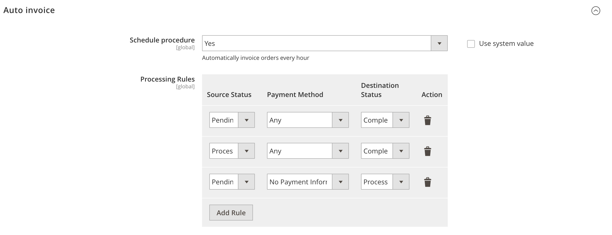

# Magento 2 Auto Invoice
Magento 2 procedure to automatically invoice orders in a given status.

[](https://github.com/aune-io/magento2-autoinvoice/actions/workflows/tests.yml)
[](https://packagist.org/packages/aune-io/magento2-autoinvoice)
[](https://packagist.org/packages/aune-io/magento2-autoinvoice)
[](https://packagist.org/packages/aune-io/magento2-autoinvoice)
[](https://packagist.org/packages/aune-io/magento2-autoinvoice)

## System requirements
This extension supports the following versions:

*	Magento Open Source / Adobe Commerce 2.4.6, 2.4.7, 2.4.8 and 2.4.9
*	PHP 8.2, 8.3, 8.4 and 8.5 (as far as each Magento release supports them)

Older Magento (2.2, 2.3, 2.4.0 - 2.4.5) and PHP (7.x, 8.0, 8.1) versions are no longer supported.
The last release supporting them is the one tagged before this change; use that if you are still on those versions.

## Installation
1. Require the module via Composer
```bash
$ composer require aune-io/magento2-autoinvoice
```

2. Enable the module
```bash
$ bin/magento module:enable Aune_AutoInvoice
$ bin/magento setup:upgrade
```

## Configuration
The configuration of this module is under _Stores > Configuration > Sales > Auto Invoice_.
There, you will be able to activate processing via cron job, and choose the behaviour of the procedure.

The configuration matrix will allow you to set on for which combinations of status and payment method the extension should invoice the orders, as well as the destination status and capture mode.
A configuration example follows.



## Usage
The module supports two different usage methods.

### Command line
The following command will execute the procedure:

```bash
$ bin/magento aune:autoinvoice:process
```

A dry run mode is also available, just to see what orders would be affected by the procedure:
```bash
$ bin/magento aune:autoinvoice:process --dry-run=1
```

### Cron
By activating the cron, the procedure will be automatically executed every hour.

1. Login to the admin
2. Go to Stores > Configuration > Sales > Auto Invoice
3. Set _Schedule procedure_ to yes
4. Specify a custom cron expression, if needed
5. Clean the cache

## Authors, contributors and maintainers

Author:
- [Renato Cason](https://github.com/renatocason)

## License
Licensed under the Open Software License version 3.0
